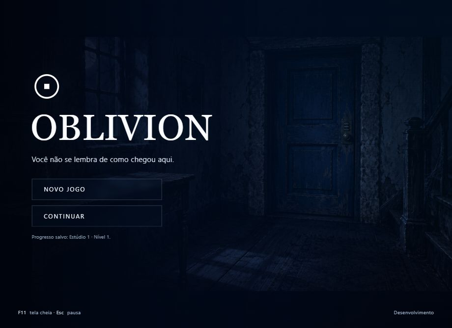
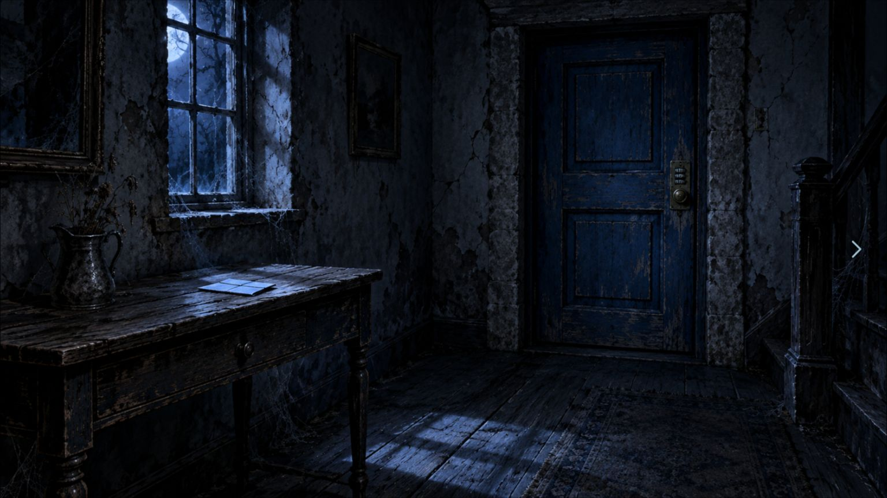

# OBLIVION

Jogo didático de terror psicológico no estilo point and click. O jogador explora cenários, encontra pistas e resolve enigmas usando o mouse em um computador. A estrutura usa HTML, CSS e JavaScript com módulos ES, sem framework, dependências externas ou compilação.

Os professores fornecem o motor. Cinco estúdios de alunos criam três níveis e uma mecânica exclusiva cada um.

## Abrir o projeto

Com Node.js instalado, abra um terminal na pasta do projeto e execute:

```powershell
npm start
```

Abra `http://localhost:8000/` no navegador. Para encerrar o servidor, use `Ctrl+C` no terminal. Não é necessário executar `npm install`.

Também é possível usar a extensão Live Server do VS Code. Como alternativa, quem já tem Python instalado pode executar `py -m http.server 8000` no Windows ou `python -m http.server 8000`. O projeto precisa de um servidor HTTP: abrir o HTML com dois cliques pelo endereço `file://` não carrega os módulos corretamente.

## Páginas disponíveis

| Página | Para que serve |
| --- | --- |
| `index.html` | Menu com **Novo jogo** e **Continuar** |
| `jogo.html?nivel=professor-inicio` | Jogar um nível da campanha |
| `dev.html` | Testar um nível, uma sequência de estúdio ou o exemplo |

Cada conclusão de nível salva o próximo nível alcançado e abre outra URL com um recarregamento completo da página. As cenas dentro do mesmo nível mudam sem recarregar.

## Jogar sem interface sobre o cenário

Na campanha, o cenário ocupa a janela disponível, sem cabeçalho ou painéis permanentes. A imagem mantém sua proporção original; podem aparecer margens pretas para evitar cortes ou distorção.

Abra o menu de pausa com **Esc** ou **clique direito sobre o cenário**. Ele reúne os controles do jogo; volte com **Esc** ou **Continuar explorando**. A opção de tela cheia e o atalho **F** usam a Fullscreen API do navegador e precisam de uma ação do jogador. Para manter a tela cheia durante as navegações reais entre níveis, prefira **F11**, o modo de tela cheia do próprio navegador.

Ao trocar de página, o navegador pode encerrar a tela cheia ativada pela Fullscreen API. Ela não é reativada automaticamente: use novamente o botão ou o atalho. O ambiente `dev.html` mantém os painéis de teste separados da experiência do jogador.

O progresso fica no `localStorage` deste navegador, com a chave `oblivion.campanha.v1`. **Continuar** reinicia o último nível alcançado, com suas pistas e estados iniciais. **Novo jogo** apaga o progresso anterior e começa no nível do professor. O salvamento não leva o progresso para outro computador, navegador ou endereço do servidor.

## O que já existe

- Motor com cenas, setas, áreas clicáveis, mensagens, modais, enigmas e estados locais.
- Tutorial do professor **A primeira porta**, com duas cenas e um único enigma de código, encerramento e um nível de exemplo funcional.
- Templates para os 15 níveis dos alunos, preparados para teste em desenvolvimento.
- Exemplo de mecânica de vela e ferramentas públicas para criar outras mecânicas.
- Modo de desenvolvimento, validação, testes e documentação.

**Os 15 níveis dos alunos ainda são rascunhos.** Eles não formam uma campanha jogável completa. O professor marca cada nível como `pronto: true` no registro depois de revisar seu conteúdo. Rascunhos podem ser abertos em `dev.html`; a campanha informa quando um nível ainda não está pronto.

## Quem edita o quê

| Área | Responsável |
| --- | --- |
| `js/core/`, `js/campaign/`, HTML e CSS compartilhados | Professor |
| `js/studios/estudio-01/` e `assets/studios/estudio-01/` | Estúdio 1 |
| Mesmas duas pastas com `02`, `03`, `04` ou `05` | Estúdio correspondente |
| `examples/`, `docs/`, scripts, testes e configuração do repositório | Professor |

O nível chama `api.concluirNivel()`. Ele não informa qual estúdio vem depois. A ordem dos 17 níveis está somente em `js/campaign/order.js`; `registry.js` informa o arquivo e a disponibilidade de cada nível.

## Caminho recomendado para os alunos

1. Leia [como o projeto funciona](docs/01-COMO-O-PROJETO-FUNCIONA.md).
2. Abra `examples/nivel-exemplo.js` e teste pelo modo de desenvolvimento.
3. Leia [como criar um nível](docs/02-COMO-CRIAR-UM-NIVEL.md) e edite os arquivos do seu estúdio.
4. Consulte a [API pública](docs/03-FUNCOES-DISPONIVEIS.md) e a [mecânica exclusiva](docs/04-MECANICA-EXCLUSIVA.md).
5. [Teste](docs/05-COMO-TESTAR.md) e siga o [fluxo Git/GitHub](docs/06-GIT-E-GITHUB.md).

Para trabalhar com IA, copie o prompt de [Uso de IA](docs/07-USO-DE-IA.md). Se algo falhar, consulte [Erros comuns](docs/08-ERROS-COMUNS.md).

A configuração das setas sobre a arte, das notas ilustradas, da identidade visual e da fonte está em [Identidade e imersão](docs/10-IDENTIDADE-E-IMERSAO.md). A fonte Divergent é usada quando está instalada localmente; o projeto usa uma fonte alternativa quando ela não está disponível.

As artes do tutorial foram criadas com ImageGen para este projeto, mantendo a identidade em azul e preto. As imagens anexadas pelo professor ficam preservadas como referências de conceito. Os prompts e a origem das novas artes estão em [Arte do tutorial](docs/ARTE-TUTORIAL.md).

## Verificar os arquivos

```powershell
npm run validar
npm test
```

O primeiro comando verifica o contrato, o registro, a ordem e os caminhos de imagens dos níveis. O segundo verifica regras do motor. Nenhum deles substitui jogar os níveis no navegador.

O professor deve criar o repositório no GitHub, configurar os responsáveis em `.github/CODEOWNERS` e proteger a `main` exigindo revisão e os checks. Essas configurações são explicadas em [Git e GitHub](docs/06-GIT-E-GITHUB.md). A liberação dos níveis e a preparação da turma estão no [Guia do professor](docs/09-GUIA-DO-PROFESSOR.md).




